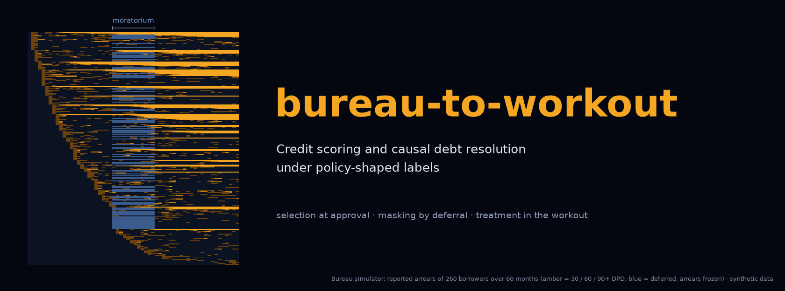
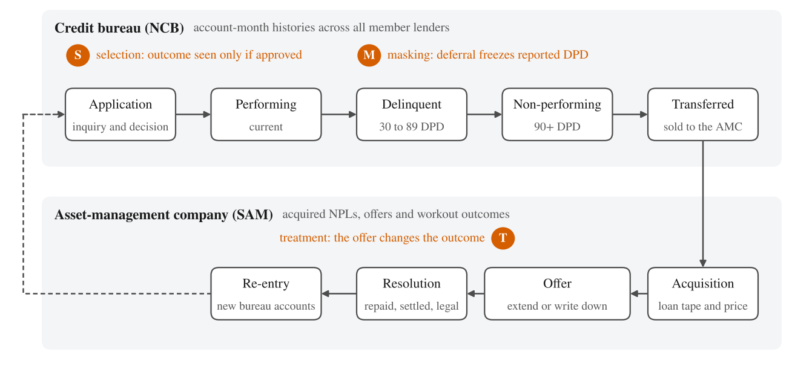

<p align="center"><a href="paper/paper.pdf"></a></p>

<p align="center">
<a href="https://github.com/thanatchon36/bureau-to-workout/actions/workflows/ci.yml"></a>
<a href="pyproject.toml"></a>
<a href="https://thanatchon36.github.io/bureau-to-workout/paper/"></a>
<a href="paper/paper.pdf"></a>
<a href="#all-data-are-synthetic"></a>
<a href="LICENSE"></a>
<a href="https://zenodo.org/badge/latestdoi/1452377934"></a>
<a href="https://huggingface.co/datasets/thanatchon36/bureau-to-workout"></a>
<a href="https://huggingface.co/thanatchon36/bureau-to-workout"></a>
</p>

<p align="center">
📖 <b><a href="https://thanatchon36.github.io/bureau-to-workout/paper/">Read the paper online</a></b> ·
📄 <b><a href="paper/paper.pdf">Download the PDF</a></b> ·
📊 <b><a href="paper_results/">Result files</a></b> ·
🤗 <b><a href="https://huggingface.co/datasets/thanatchon36/bureau-to-workout">Dataset</a></b> ·
🤗 <b><a href="https://huggingface.co/thanatchon36/bureau-to-workout">Models</a></b> ·
🔁 <b><a href="#install-and-quickstart">Reproduce</a></b>
</p>

**Credit scoring and causal debt resolution under policy-shaped labels.** Credit-risk models learn from labels
that the credit system itself produces: lenders see repayment only for applicants they approve, debt-relief
programmes suspend the reporting of arrears, and collectors decide which distressed borrowers receive concessions.
This repository studies these three mechanisms, **selection**, **masking** and **treatment**, along the debt
lifecycle that a national credit bureau (NCB) linked to a public asset-management company (SAM) would reveal. It
proposes an estimator for each and tests them in two simulators that keep the ground truth.



> <a id="all-data-are-synthetic"></a>**All data here are synthetic.** No NCB or SAM data were used. Every number is
> a property of the simulators, whose parameters were chosen to make the mechanisms visible at plausible
> magnitudes. None is an estimate for Thailand. The simulators exist because they record what real data never
> can: the outcomes of rejected applicants, arrears hidden by deferral, and every borrower's response to every
> offer.

## Install and quickstart

```bash
make setup      # uv venv + dependencies (Python 3.12)
make all        # experiments -> tables -> figures -> paper   (about 3 minutes)
make test       # 12 tests: simulators, budgeted policy, off-policy evaluation, paper tables
```

Outputs: `paper_results/` (every experiment over five seeds), `paper/tables/` and `paper/results_macros.tex`
(generated), `paper/figures/` (PDF for LaTeX, PNG previews), `paper/paper.pdf` and the web reader `docs/paper/`.

| Target | Purpose |
|---|---|
| `bureau` | One seed of the bureau experiments E1–E5 → `lab_outputs/` (about a minute) |
| `workout` | One seed of the workout experiments R1–R4 → `resolution_outputs/` (a few seconds) |
| `experiments` | Every experiment over five seeds → `paper_results/` |
| `tables` | `paper_results/` → `paper/tables/` and the number macros `paper/results_macros.tex` |
| `figures` | `paper_results/` → `paper/figures/` |
| `banner` | README banner → `docs/assets/banner.png`, drawn from bureau-simulator output |
| `paper` | `paper/main.tex` → `paper/paper.pdf` (tectonic) and the web reader `docs/paper/` (pandoc) |
| `hf` / `hf-push` | Hugging Face dataset and model repos → `build/hf/`; `hf-push` uploads them (`uv pip install -e ".[hf]"`) |
| `web` | Web reader only → `docs/paper/index.html`, served at <https://thanatchon36.github.io/bureau-to-workout/paper/> |

## Key results

Simulation results, mean of five seeds.

| Mechanism | Metric | Standard practice | Proposed | Oracle |
| --- | --- | --- | --- | --- |
| Selection | Predicted ÷ observed default, rejected applicants | 0.55 (approved-only) | 0.86 (bureau-augmented) | 0.89 |
| Masking | Out-of-time AUC after a moratorium | 0.625 (reported labels) | 0.831 (delayed labels) | 0.838 |
| Treatment | Recovery value, % of balance | 55.55 (logged policy) | 57.22 (causal targeting) | 57.97 |
| Treatment | Write-downs, % of balance | 10.4 (logged policy) | 4.4 (causal targeting) | 2.9 |

## What the code does

1. **Bureau simulator** (`bureau_to_workout.bureau`): 50,000 borrowers over 60 months, six lenders (one lenient), a
   macro shock and an optional moratorium. It keeps latent ability, lenders' soft information and the
   counterfactual world without deferral, so every method is scored against the truth.
2. **Scoring models**: a weight-of-evidence scorecard with monotone binning and points, a monotone gradient-boosted
   classifier, and a masked self-supervised sequence encoder whose embeddings feed the GBM (E1, out of time).
3. **Selection** (E2): approved-only training, IPW, fuzzy augmentation, bureau-augmented labels that use repayment
   observed at other lenders, and an oracle trained on every applicant's outcome.
4. **Masking** (E3): naive reported labels, excluding deferred windows, and delayed labels that extend the outcome
   window past the end of the moratorium, against the no-deferral counterfactual.
5. **Groups and reasons** (E4, E5): calibration and approval by group at one cut-off, a points table and
   adverse-action reason codes.
6. **Workout simulator** (`bureau_to_workout.workout`): 50,000 NPL cases and four offers (standard, term
   extension, write-down, both) whose effects run through liquidity and debt overhang; sixty officers choose the
   logged offers. Every potential outcome is kept.
7. **Treatment** (R1–R4): T-learner against a cross-fitted DR-learner, write-down-budgeted offer policies (status
   quo, uniform, predictive, causal, oracle), the budget frontier, and off-policy evaluation by DM, IPS and DR.
8. **Paper** (`experiments`, `tables`, `figures`, `paper_web`): five seeds, then tables and number macros that the
   LaTeX source reads, so no number in the paper is typed by hand.

## Research: *From Bureau to Workout: Credit Scoring and Causal Debt Resolution under Policy-Shaped Labels*

The preprint by Thanatchon Chongmankhong is in [`paper/`](paper/): a PDF in [`paper/paper.pdf`](paper/paper.pdf),
its LaTeX source in [`paper/main.tex`](paper/main.tex) (arXiv preprint style, with `main.bbl` kept for arXiv), and a
web version at <https://thanatchon36.github.io/bureau-to-workout/paper/>. Every number in the text comes from
`paper/results_macros.tex`, which `make tables` generates from `paper_results/`.

- Tables: [`paper/tables/`](paper/tables/) · Figures: [`paper/figures/`](paper/figures/) · Results: [`paper_results/`](paper_results/)
- Dataset on Hugging Face: [`thanatchon36/bureau-to-workout`](https://huggingface.co/datasets/thanatchon36/bureau-to-workout), with the simulated bureau panels
  (50,000 borrowers × 60 months, with and without a moratorium), the E1, E2 and E3 modelling tables, the 50,000
  workout cases with every potential outcome, and every result file
- Models on Hugging Face: [`thanatchon36/bureau-to-workout`](https://huggingface.co/thanatchon36/bureau-to-workout): the WoE scorecard (JSON), monotone GBM,
  SSL encoder, the six E2 reject-inference models, the E3 models, the workout outcome and propensity models and the DR-learner (skops, no pickle)
- Section 7 sets out identification strategies for the linked NCB × SAM data and a privacy-preserving linkage design.

| ID | Question | Code | Paper |
| --- | --- | --- | --- |
| E1 | Do self-supervised sequence embeddings beat a monotone GBM out of time? | `run_e1` in `bureau.py` | Section 6.1 |
| E2 | How biased is approved-only training, and how much do bureau-observed outcomes repair? | `run_e2` | Section 6.2 |
| E3 | What does a moratorium do to labels, and which labelling strategy repairs it? | `run_e3` | Section 6.3 |
| E4 | Does calibration hold across groups after a regime shift? | `run_e4` | Section 6.4 |
| E5 | Scorecard points and adverse-action reason codes | `run_e5` | Appendix C |
| R1–R4 | Offer effects, budgeted offer policies, budget frontier, off-policy evaluation | `run_all` in `workout.py` | Section 6.5 |

## Repository layout

```
src/bureau_to_workout/
  bureau.py                 bureau simulator, WoE scorecard, monotone GBM, SSL encoder; experiments E1-E5
  workout.py                workout simulator, DR-learner, budgeted offer policies, off-policy evaluation
  experiments.py            every experiment over five seeds -> paper_results/
  tables.py                 paper_results/ -> paper/tables/ and paper/results_macros.tex
  figures.py                paper_results/ -> paper/figures/
  paper_web.py              paper/main.tex -> docs/paper/ (web reader)
  cli.py                    python -m bureau_to_workout.cli {bureau,workout,experiments,tables,figures,paper,web}
paper_results/              experiment outputs used by the tables and figures
paper/                      main.tex, references.bib, main.bbl, reader.html, tables/, figures/, paper.pdf
docs/                       GitHub Pages: the web reader (docs/paper/) and the banner
scripts/make_banner.py      README banner
scripts/export_hf.py        Hugging Face dataset and model repos (cards in scripts/hf_cards/)
tests/                      simulators, policies, off-policy evaluation, paper tables and web reader
```

## Going from synthetic to real

The estimators do not depend on the simulators.

1. Replace `simulate_bureau()` with a loader that fills the same `BureauPanel` arrays from an account-month table.
2. Replace `simulate_workouts()` with a loader for the workout file that fills `Workouts`.
3. Do this only inside an approved secure environment, with a lawful purpose under the Credit Information Business
   Act B.E. 2545 and the Personal Data Protection Act B.E. 2562, a data-protection impact assessment and ethics
   review. Section 7 of the paper sets out identification strategies for the linked data.

## Limitations

Simulation results show what methods can recover under stated assumptions, not what the Thai credit market looks
like. The functional forms and parameters are design choices; in the bureau simulator, repayment at other lenders is
a perfect proxy, so bureau augmentation is evaluated in its best case; the workout simulator satisfies
unconfoundedness and overlap by construction. The committed `paper_results/` were produced with an earlier set of
library versions; rerunning `make experiments` with current numpy, pandas and scikit-learn moves some numbers in the
third decimal; the Hugging Face models were fitted with current versions and their card reports their own metrics. See paper Section 8.

## Citation

See [`CITATION.cff`](CITATION.cff); each release is archived on Zenodo, concept DOI
[10.5281/zenodo.24102251](https://doi.org/10.5281/zenodo.24102251) (DOI badge above). License: MIT.

```bibtex
@misc{chongmankhong2026bureau,
  author = {Chongmankhong, Thanatchon},
  title  = {From Bureau to Workout: Credit Scoring and Causal Debt Resolution under Policy-Shaped Labels},
  year   = {2026},
  note   = {Preprint},
  doi    = {10.5281/zenodo.24102251},
  url    = {https://thanatchon36.github.io/bureau-to-workout/paper/}
}
```

## สรุปภาษาไทย

Repository นี้รวม paper และโค้ดอ้างอิงของงานวิจัย credit scoring บนข้อมูลแบบ NCB และโมเดลแก้หนี้ NPL บนข้อมูลแบบ บสส. งานศึกษา 3 กลไกที่ทำให้ label ในระบบสินเชื่อถูกบิด ได้แก่ การคัดเลือกผู้ได้รับอนุมัติ การพักหนี้ที่บดบังการค้างชำระ และข้อเสนอแก้หนี้ที่เปลี่ยนผลลัพธ์เอง พร้อมเสนอวิธีแก้สำหรับแต่ละกลไก ทุกตัวเลขมาจากข้อมูลจำลอง ไม่ได้ใช้ข้อมูลจริงของ NCB หรือ บสส. และไม่ใช่ค่าประมาณของประเทศไทย อ่าน paper ออนไลน์ได้ที่ <https://thanatchon36.github.io/bureau-to-workout/paper/> และรันซ้ำทุกตัวเลขได้ด้วย `make setup && make all`
